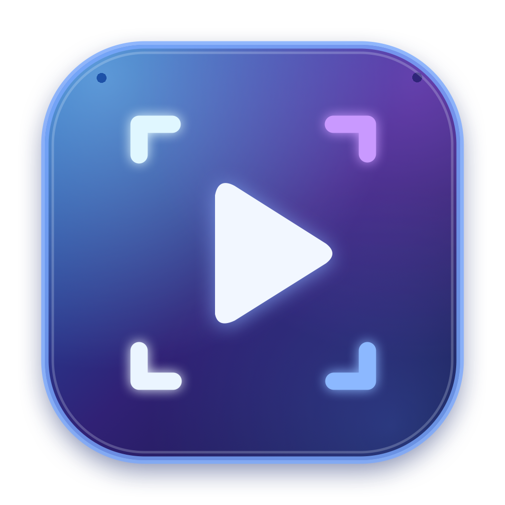

# CLIP



A native macOS instant replay utility. CLIP keeps a rolling screen-capture buffer and saves recent footage when you press **⌘ Shift S**. Preview, trim, and organise recordings without uploading them to a service.

**Stack:** SwiftUI · ScreenCaptureKit · AVFoundation  
**Status:** Preview release · Apple Silicon · macOS 15+

## Features

- **Instant replay:** Press **⌘ Shift S** to save your recent footage as an MP4. CLIP verifies that the buffer is fresh rather than exporting old footage again.
- **Rotary replay dial:** Choose 15 seconds, 30 seconds, 1, 2, 3, 5, or 10 minutes.
- **Audio control:** Include system/game audio; optionally enable microphone recording.
- **Quality settings:** 720p, 1080p, 1440p or native resolution; 30 or 60 FPS targets.
- **Clip library:** Browse thumbnails, preview clips, show videos in Finder, and move unwanted recordings to Trash.
- **Two-handle trim editor:** Open a saved clip and drag the start/end handles on the thumbnail timeline. Preview the selected segment and export a new MP4 with system audio; the original remains unchanged.
- **Glass UI:** Translucent controls, trackpad haptics where supported, motion accessibility support.
- **Menu bar:** Background capture, quick save/pause, and launch-at-login preference.
- **Capture recovery:** Detects when screen frames stop updating, attempts to reconnect, and avoids a misleading duplicate clip. The dashboard shows buffer readiness (for example, `17/30s`) and a friendly explanation when a full fresh clip is not yet ready. If capture stops repeatedly (for example while the Mac is locked), open CLIP and press Start after waking it.
- **Local files:** Saved videos live in `~/Movies/CLIP`.

> **Preview release:** CLIP is an early project, not a production-equivalent replacement for Medal. Current capture uses the first available display rather than game-specific capture. Some games, protected videos, and system configurations may not capture perfectly. Microphone capture is selectable but has not been extensively field-tested.

### Replay behaviour (v0.4.1)

CLIP now handles unchanged desktops correctly: ScreenCaptureKit reports an *idle* frame instead of emitting another image when nothing changes. A lightweight timer extends the last visible frame with new timestamps, allowing normal 30-second replays even on static screens. Press **⌘ Shift S** to save the most recent selected duration; the saved video is never replaced with an older clip. After a fresh app launch, if fewer than 30 seconds have elapsed, CLIP saves the shorter amount recorded so far and labels the file as a short replay. Sleeping, locked or otherwise unavailable displays cannot be retrospectively recorded.

## Download and install

Get the latest **CLIP-macOS-arm64** ZIP from [Releases](../../releases).

1. Unzip the download and move **CLIP.app** to **Applications**.
2. Open CLIP. On first launch, macOS may block the app because this preview build is **not Apple-notarized**. Review the application and use macOS **Privacy & Security → Open Anyway** if you trust this release.
3. Grant **Screen & System Audio Recording** access to CLIP.
4. CLIP will maintain a rolling recording buffer. Press **⌘ Shift S** to save a replay.
5. Use Settings to change duration, microphone, quality, frame rate, notification and login options.

**Requirements:** Apple Silicon Mac, macOS **15.0 or later**. Liquid Glass appearance is best on macOS 26.

**Privacy:** CLIP captures only after macOS grants recording permission. It stores clips locally. Be considerate of other people's privacy and obtain appropriate consent.

### About signing

Prebuilt preview downloads are **ad-hoc signed**, but **not notarized** or distributed with a Developer ID certificate. Gatekeeper warnings are expected. Do not disable Gatekeeper system-wide. A future public production release should be signed with Developer ID and notarized through Apple.

## Build from source

Install full Xcode and its command-line tools, then run:

```bash
git clone https://github.com/buzzword365/CLIP.git
cd CLIP
zsh build.sh
open ~/Applications/CLIP.app
```

To sign the local build with a code-signing identity you own:

```bash
CLIP_SIGN_IDENTITY="Your code signing identity" zsh build.sh
```

To place the build elsewhere, set `CLIP_APP_OUTPUT` to the desired `.app` path.

To regenerate the logo artwork from source:

```bash
swift Tools/render_icon.swift
```

## Repository layout

```text
Sources/           SwiftUI app, UI interactions, recording engine
Assets/            Original CLIP icon artwork and macOS .icns
Tools/             Script to regenerate logo artwork
Info.plist         macOS bundle metadata and privacy descriptions
build.sh           Portable Apple Silicon build script
```

## Known limitations

- Captures the first detected display. Selecting specific windows/games isn't implemented.
- No multi-track editor, webcam overlay or automatic highlight detection yet.
- File format uses H.264/AAC. Frame rate and output dimensions depend on the captured display and system performance.
- Mac screen and microphone permissions are controlled by macOS.
- Advanced audio mixing and long-session stress testing need additional QA.

## License

**No open-source license has been granted.** The source is publicly visible for inspection and education; reuse or redistribution of this project requires the copyright holder's permission. The project is unaffiliated with Medal.tv.

## Security

Please report security issues privately to the repository maintainer rather than posting sensitive recordings publicly.
